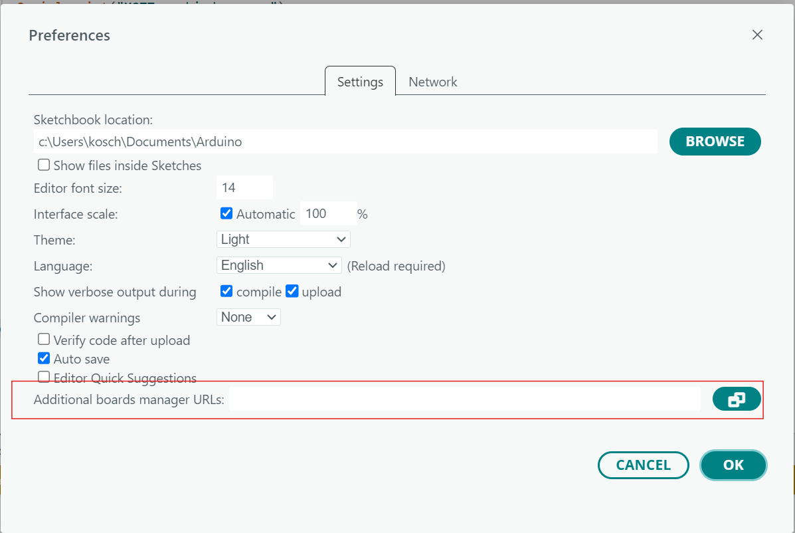
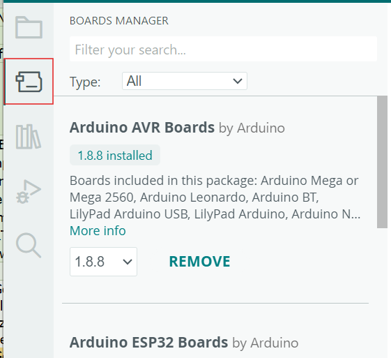
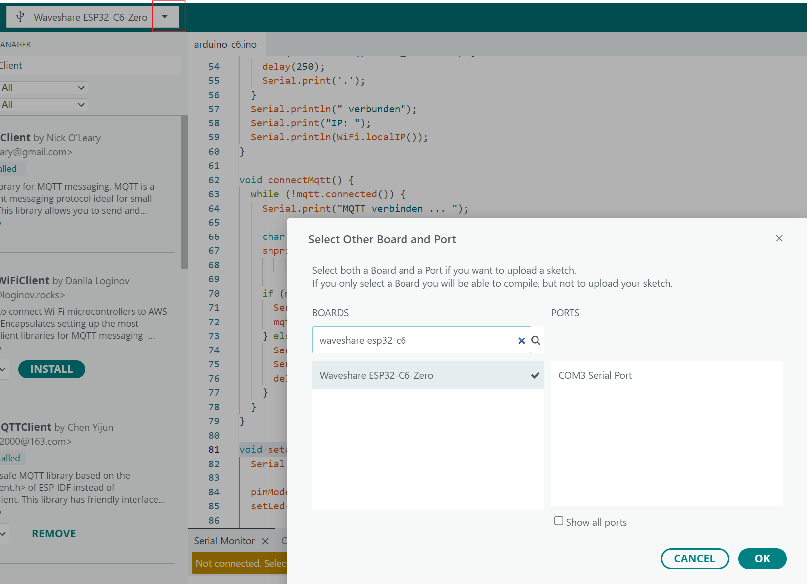
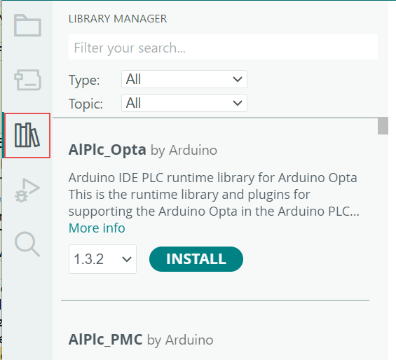

# Arduino CLI, ESP32-C6 und MQTT-Bibliotheken einrichten

## Arduino CLI installieren

Öffne ein Terminal (unter Windows z. B. PowerShell) und führe **den Installationsbefehl für dein Betriebssystem** aus:

### Linux

Benötigt `curl` und `sh`. Das offizielle Installationsskript legt `arduino-cli` in `~/.local/bin` ab:

```sh
mkdir -p "$HOME/.local/bin" && curl -fsSL https://raw.githubusercontent.com/arduino/arduino-cli/master/install.sh | BINDIR="$HOME/.local/bin" sh

sudo usermod -aG dialout "$USER"
newgrp dialout
```

Alternativ ist das Kommandozeilentool auch im Snap-Store verfügbar.

### macOS

Benötigt [Homebrew](https://brew.sh/):

```sh
brew install arduino-cli
```

### Windows

Benötigt [winget (Windows-Paket-Manager)](https://learn.microsoft.com/de-de/windows/package-manager/winget/):

```powershell
winget install --id ArduinoSA.CLI --exact
```

## Schritte nach der Installation

Starte dein Terminal nach der Installation neu. `arduino-cli` muss über `PATH` erreichbar sein (unter Linux insbesondere `~/.local/bin`. Falls das bei dir nicht klappt, füge das Verzeichnis deinem `PATH` hinzu). Prüfe die Installation und richte die CLI ein:

```sh
arduino-cli version
arduino-cli config init
```

Der Befehl `config init` erstellt eine Standardkonfiguration, falls ihr das schon früher erledigt habt, überspringe diesen Schritt.

### Was sind Arduino-Plattformen?

Im Kontext der Mikrocontroller ist mit **Plattform** nicht das Betriebssytem Linux, macOS oder Windows gemeint, sondern ein installierbares **Boardpaket (Core)**, das Unterstützung für eine Mikrocontroller-Familie bietet. Es enthält Boarddefinitionen, den Arduino-Core (Standardbibliothek) sowie die benötigten Compiler- und Upload-Werkzeuge. Beispiele sind `arduino:avr` für klassische Arduino-Boards und `esp32:esp32` für ESP32-Boards. Die Arduino CLI allein liefert standardmäßig keinen ESP32-Support. Für unseren **ESP32-C6** verwenden wir das Paket **„esp32“ von Espressif Systems**.

### ESP32-C6 über die CLI vorbereiten

Diese Befehle sind unter Linux, macOS und Windows identisch. Zuerst die [offizielle stabile Paket-URL von Espressif](https://docs.espressif.com/projects/arduino-esp32/en/latest/installing.html) hinzufügen, dann den Index aktualisieren und den Core installieren:

```sh
arduino-cli config add board_manager.additional_urls https://espressif.github.io/arduino-esp32/package_esp32_index.json
arduino-cli core update-index
arduino-cli core install esp32:esp32
arduino-cli core list
arduino-cli board listall C6
```

`core list` bestätigt die Installation; `board listall C6` zeigt passende Boardnamen und FQBNs. Schließe das Board mit einem **datenfähigen** USB-Kabel an und prüfe mit `arduino-cli board list` den erkannten Port. Ist das Board nicht automatisch zugeordnet, wähle die FQBN aus `board listall` entsprechend deinem Boardmodell (Waveshare ESP36 C6-Zero) selbst. Für spätere Workshop-Sketches kannst du damit `arduino-cli compile --fqbn <FQBN> <Sketch-Ordner>` und `arduino-cli upload -p <Port> --fqbn <FQBN> <Sketch-Ordner>` verwenden; `<FQBN>`, `<Port>` und `<Sketch-Ordner>` sind Platzhalter.

### WiFiClient für den ESP32-C6

Ein Boardpaket enthält nicht nur Boarddefinitionen und Werkzeuge, sondern kann auch Bibliotheken und Beispiele für die Funktionen des Mikrocontrollers mitliefern. Das **ESP32-Boardpaket von Espressif** enthält die WiFi-Bibliothek für WLAN-Verbindungen. In den Workshop-Sketches verwenden wir daraus unter anderem die Klasse **`WiFiClient`**:

```cpp
#include <WiFi.h>

WiFiClient wifiClient;
```

`WiFiClient` ist eine Netzwerk-Bibliothek, die für die Verbindung zum MQTT-Broker verwendet werden kann. Weitere Informationen zu dieser Bilbiothek findest du in der [ESP32-Wi-Fi-Dokumentation](https://docs.espressif.com/projects/arduino-esp32/en/latest/api/wifi.html).

### MQTT-Bibliotheken über die CLI installieren

[PubSubClient von Nick O'Leary](https://docs.arduino.cc/libraries/pubsubclient/) ist eine MQTT-Client-Bibliothek. Diese beinhalten Quelltext, der für mehrere Boardfamilien verwendet werden kann. Installiere sie nach dem ESP32-Core unter Linux, macOS und Windows mit denselben Befehlen:

```sh
arduino-cli lib update-index
arduino-cli lib install PubSubClient
arduino-cli lib list
arduino-cli lib install "PicoMQTT"
```

Prüfe in der Ausgabe von `lib list`, ob die Bibliothek installiert ist. Mehr zu ihrer Dokumentation und dem Speicherbedarf steht unter [Bibliotheken und Boardpakete verstehen](libraries.md).

### Arduino IDE 2: Boardpaket und Bibliothek installieren

Die CLI und die IDE können potentiell Boardverwalter und Bibliotheken unabhängig voneinander konfigurieren. Wenn du statt oder zusätzlich zu der CLI die IDE verwendest, prüfe daher dort, ob Paket-URL, ESP32-Boardpaket und MQTT-Bibliotheken verfügbar sind, auch wenn du sie bereits per CLI eingerichtet hast.

1. In der Arduino IDE unter **Datei → Voreinstellungen** die URL `https://espressif.github.io/arduino-esp32/package_esp32_index.json` bei **Zusätzliche Boardverwalter-URLs** eintragen (vorhandene URLs nicht löschen).

   

2. Den **Boardverwalter** über das Platinen-Symbol in der linken Seitenleiste öffnen. Dort nach `esp32` suchen und **„esp32“ von Espressif Systems** installieren; die stabile Version wählen.

   

3. Die IDE gegebenenfalls neu starten, unter **Werkzeuge → Board** das passende ESP32-C6-Board und unter **Werkzeuge → Port** den Anschluss auswählen.

   

Falls benötigt, installiere anschließend **PubSubClient** über den **Bibliotheksverwalter** der Arduino IDE 2:

1. Den **Bibliotheksverwalter** über das Bücher-Symbol in der linken Seitenleiste öffnen (alternativ **Sketch → Bibliothek einbinden → Bibliotheken verwalten…**).

   
2. Nach `PubSubClient` suchen. Den Eintrag **„PubSubClient“ von Nick O'Leary** auswählen, nicht ähnlich benannte Bibliotheken.
3. Auf **Installieren** klicken.

Quellen: [Arduino CLI – Installation](https://docs.arduino.cc/arduino-cli/installation/), [Arduino CLI – Getting started](https://docs.arduino.cc/arduino-cli/getting-started/), [Arduino – Plattformen](https://docs.arduino.cc/arduino-cli/platform-specification/), [Espressif – Arduino-ESP32 installieren](https://docs.espressif.com/projects/arduino-esp32/en/latest/installing.html), [Espressif – Wi-Fi API](https://docs.espressif.com/projects/arduino-esp32/en/latest/api/wifi.html), [Arduino – PubSubClient](https://docs.arduino.cc/libraries/pubsubclient/), [Arduino – PicoMQTT](https://docs.arduino.cc/libraries/picomqtt/), [PicoMQTT-Projektdokumentation](https://github.com/mlesniew/PicoMQTT), [Arduino IDE 2 – Bibliotheken installieren](https://docs.arduino.cc/software/ide-v2/tutorials/ide-v2-installing-a-library/), [winget-Paket ArduinoSA.CLI](https://github.com/microsoft/winget-pkgs/tree/master/manifests/a/ArduinoSA/CLI).
