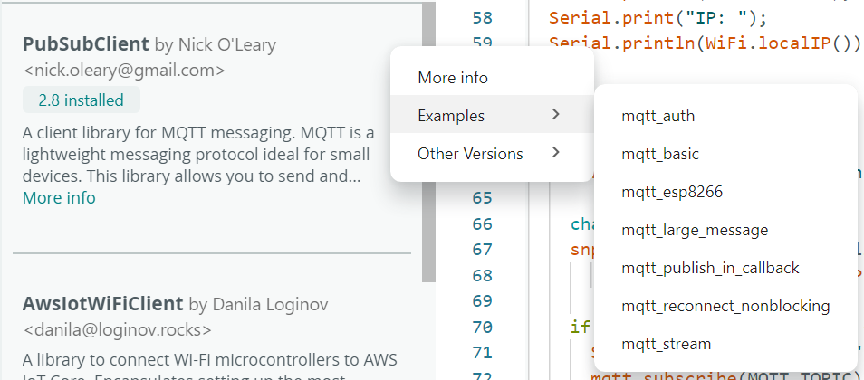

# Dokumentation von Bibliotheken und Boardpaketen finden

In Arduino werden Erweiterungen „Plugins“ genannt. Dabei unterscheiden wir **Boardpakete (Cores)** wie `esp32:esp32`, die ein bestimmtes Board erst nutzbar machen, und **Bibliotheken** wie z.B. PubSubClient oder PicoMQTT, die Funktionen bereitstellen.

Passende Dokumentation findest du je nach deinem Entwicklungstool:

1. **In der Arduino IDE:** Im **Boardverwalter** nach `esp32` bzw. im **Bibliotheksverwalter** nach `PubSubClient` oder `PicoMQTT` suchen. Prüfe **Name und Autor**; ähnlich benannte Pakete können andere Funktionen anbieten. Im Drei-Punkte-Menü findest du einen Link mit weiteren Informationen zu den Bibliotheken. Bei installierten Bibliotheken findest du lauffähige Beispiele zudem unter **Datei → Beispiele → Name der Bibliothek**.

   

2. **Im Arduino-Bibliotheksverzeichnis:** Die Seiten zu [PubSubClient](https://docs.arduino.cc/libraries/pubsubclient/) und [PicoMQTT](https://docs.arduino.cc/libraries/picomqtt/) nennen Autor, unterstützte Architekturen, Versionen und das Projekt-Repository. Dort findet ihr README, Beispiele, API-Beschreibung und bekannte Einschränkungen. Für den ESP32-Core sind die [Dokumentation von Espressif](https://docs.espressif.com/projects/arduino-esp32/en/latest/) und deren [Installationshinweise](https://docs.espressif.com/projects/arduino-esp32/en/latest/installing.html) die erste Anlaufstelle.
3. **Mit der CLI:** `arduino-cli lib search PicoMQTT` zeigt Paketinformationen, `arduino-cli lib examples PicoMQTT` die enthaltenen Beispiel-Sketches und `arduino-cli core list` die installierten Boardpakete. Für APIs und Besonderheiten folge anschließend der Website oder dem Repository des jeweiligen Projekts. Die CLI-Hilfe zu einem Befehl liefert `arduino-cli help lib` bzw. `arduino-cli help core`.

Bei Problemen ist die jeweilige README und in den Beispielen **der installierten Version** nach: Beispiele im aktuellen `main`-/`master`-Branch können eine neuere API verwenden. `#include <PubSubClient.h>` und `#include <PicoMQTT.h>` zeigen, welche Bibliothek der jeweilige Sketch benutzt. Die beiden Bibliotheken sind nicht automatisch austauschbar, und unterstützen teilweise unterschiedliche Boardmodelle.
Vor allem auf Boards mit geringem Speicher können Bibliotheken diesen schnell ausreizen.

## Warum Bibliotheken verwenden?

**Vorteile:** Sie kapseln komplexe Aufgaben wie MQTT, sparen Implementierungszeit und bieten Beispiele sowie erprobte Schnittstellen. PicoMQTT kann zusätzlich einen Broker auf dem ESP32 betreiben, PubSubClient ist auf die Client-Seite ausgerichtet. Welche Bibliothek passt, hängt vom Sketch und ihren dokumentierten Einschränkungen ab.

**Nachteile:** Bibliotheken bringen Abhängigkeiten, Versionsunterschiede und möglicherweise nicht benötigte Funktionen mit. Achte auf Wartung, Lizenz und Kompatibilität; insbesondere kann ein großer Funktionsumfang auch mehr Speicher und Rechenzeit benötigen.

### Flash und RAM sind verschieden

- **Flash** speichert das kompilierte Programm dauerhaft. Der Speicherplatz auf einem Mikrocontroller ist begrenzt; der installierte Quellcode auf deinem Computer ist **nicht** gleich der Größe des hochgeladenen Programms. Der Compiler/Linker übernimmt nur tatsächlich benötigte Teile, soweit die Implementierung und Optimierung das erlauben. Verschiedene Bibliotheken, Core-Versionen und Einstellungen können die fertige Firmware unterschiedlich groß machen.
- **RAM** wird zur Laufzeit für globale Daten, Stack, Heap und Netzwerkpuffer gebraucht. Gerade MQTT-Nachrichten, Verbindungen und zusätzliche Broker-Clients können RAM beanspruchen. Freier Flash bedeutet nicht automatisch genügend freien RAM; zu wenig RAM kann zu instabilem Verhalten führen.
- **Installiert ≠ verwendet:** Mehrere Bibliotheken auf dem Computer zu installieren belegt zunächst Speicher **auf dem Computer**, nicht auf dem Board. Erst was ein Sketch einbindet und tatsächlich nutzt, kann Flash und RAM auf dem Mikrocontroller kosten. Auch ein `#include` allein sagt noch nicht zuverlässig, wie viel Speicher am Ende belegt wird.

**Praxis:** Kompiliere denselben Sketch für dasselbe Board mit der benötigten Funktionalität und vergleiche die **Flash- und RAM-Angaben der Build-Ausgabe** der Arduino IDE (Schaltfläche **Überprüfen**) oder der CLI (`arduino-cli compile --fqbn <FQBN> <Sketch-Ordner>`). Die angezeigte RAM-Belegung erfasst in der Regel vor allem statisch belegten Speicher, **nicht** den maximalen Bedarf von Heap und Stack zur Laufzeit. Vergleiche bei PubSubClient und PicoMQTT nicht bloß die Downloadgröße der Bibliotheken: Entscheidend ist die tatsächliche Firmware für dein Board und die benötigten Funktionen. Entferne ungenutzte Funktionen und Bibliotheken aus dem Sketch und prüfe die Größe nach Änderungen erneut. Hinweise zur Installation stehen in der [Einrichtungsanleitung](arduino-cli.md).
